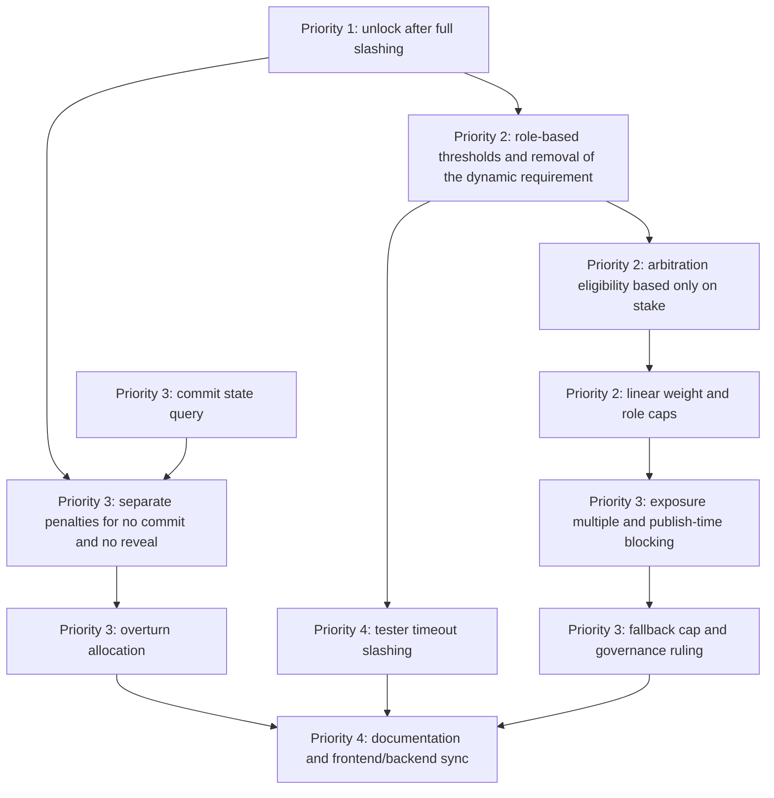

# Staking Thresholds and Reward/Penalty Mechanism: Requirements Specification (Confirmed)

> Version: v1.0 · 2026-10-24 · Pricing unit: AGT
> Applies to: admission thresholds, stake caps, locking, slashing, and rewards for the publisher pool, tester pool, and arbitration pool (including reviewers).
> All clauses in this document are final requirements. After implementation, the conclusions must be written back into sections 2.3, Chapter 5, Chapter 7, and Chapter 8 of `01-RULES.md`.
> Each parameter is given by name first; the parameter identifiers used in code are listed together in the parameter table in Chapter 9.

---

## 1. Goals and Scope

### 1.1 Goals

1. Admission to arbitration and testing depends only on token stake, with no historical conditions.
2. The stake magnitudes of the three pools match the risks each pool bears.
3. Slashing and rewards float with the disputed value, so that the expected return of honest participation is positive and that of malice is negative.
4. For any published task, its disputed value lies within the economic safety range of the arbitration pool.

### 1.2 In scope

- Admission, caps, weights, and locking for the three pools: publishing, testing, and arbitration (including reviewers).
- Slashing, rewards, and slashing destinations for arbitration and testing.
- Task disputed value cap, publish-time blocking, degradation, and fallback path constraints.
- The corresponding contracts, parameters, documentation, and frontend/backend synchronization.
- Economic model v3: the task deduction `C` **goes 100% into the platform treasury `PlatformTreasury`** and is no longer split 65/15/10/10 among Agents; all Agent rewards come from mining emission (platform 10% / executor 65% / tester 15% / arbitrator 10%). Executor / tester / arbitrator shares for periods with no participants are sent to the zero address and burned (AGT `burn`, `totalSupply` decreases).
- Case fee balances, overturned slashing shares, executor debt shares, and arbitration pool excess still go to `PlatformTreasury` (they are not burned). The platform treasury is a separate account, not the 800 million AGT incentive vault `IncentiveVault`; deployment validates that the two are not identical.
- The rejection bond is deprecated and unified into the appeal fee (`computeAppealFee`), paid 100% to revealed jurors.
- Known exception: the token project (`agent-grid-contracts/token`) is out of scope for this phase; the `TaxDistributor` transaction-tax burn share and `AGTToken.burn()` remain unchanged.

### 1.3 Out of scope

| Item | Handling this phase | Reason for not doing it | Alternative this phase |
|---|---|---|---|
| Role mutual exclusion | Unchanged | Within one task a wallet can hold only one role; already implemented and unrelated to this reward/penalty and threshold adjustment | — |
| Publisher stake formula | Unchanged | Publisher stake automatically scales with reserves; T5 (28 days) needs about 420,000, the same order of magnitude as the arbitration threshold, so no adjustment is needed | — |
| Grade B collusion committee | Not doing | Requires a new multisig committee, evidence standards, and delayed execution, which is a new governance mechanism; the evidence standard (which off-chain evidence plus on-chain corroboration suffices for slashing) is not yet defined, and launching hastily would introduce wrongful-slashing risk | Only on-chain verifiable grade A collusion triggers confiscation of the full stake and a permanent ban; chat-screenshot-only evidence must not be grounds for slashing |
| 30-day slashing lock account | Not doing | Its purpose is to leave a rollback window for review overturns; this phase has no protocol review layer, so there is nothing to roll back | The final instance is final; slashing executes immediately |
| Protocol review layer | Not doing | Requires a new reviewer role, bonds, and a ruling process, exceeding the scope of this "reward/penalty and admission" change; how to recover already-distributed slashes after a review overturn is undefined | The final instance is final; single-case risk is bounded by the cap "disputed value does not exceed exposure multiple times stake" and by publish-time blocking |
| Related-cluster exclusion | Not doing | The related-cluster field in the registry has no writer and is always empty on-chain; enabling it requires first deciding who writes it and on what data the same controller is determined, which is an off-chain identity and data-source problem outside staking and slashing rules | Keep the per-case evidence mechanism: when a case opens, the protocol-signed case proof submits a recusal list and funding sources, and the same-source weight share is capped by the "same-source weight share cap"; plus linear weight so splitting addresses does not increase total weight, and each address still needs 1,000,000 stake |
| Tester quality penalty (report inconsistent with the final outcome) | Not doing | A report inconsistent with the final outcome may be honest disagreement and cannot be distinguished from malice on-chain; penalizing it would punish honest minority opinions | Penalize only objectively determinable behavior: missing the report before the timeout (see 7.6) and grade A collusion |

---

## 2. Terms and Symbols

| Symbol | Name | Meaning |
|---|---|---|
| V | Disputed value | The disputed executor pool amount, passed by the task escrow contract to the arbitration court when the case opens |
| Y | Reserve | Task reserve = highest-tier daily fee × run days, locked when the task is published |
| V_cap | Disputed value upper bound | `Y × executor share ratio` (65%) |
| S | Stake | Stake amount of a single validator |
| Arbitration admission stake, tester admission stake | Admission threshold | Minimum stake for the arbitration pool and the tester pool respectively |
| F | Case fee | `max(5% × V, 6 AGT)` |
| L | Per-case lock | The stake a juror locks for one case |
| R | Per-seat majority fee | `F × 70% ÷ number of final-instance majority jurors` |
| p | Collusion detection rate | Probability that collusion is detected and slashed; taken as 30% |
| k | Must-bribe count | To keep a wrong result, the minimum number an attacker must bribe = `⌊final jurors ÷ 2⌋ + 1` |
| μ | Exposure multiple | `k × p`, with the constraint `V ≤ μ × S` |
| U | Disputed value cap | Maximum disputed value allowed to be published under the current mode |
| Z | Total slashed | Total slashed from the first-instance majority |

---

## 3. Final Decisions

### 3.1 Thresholds and caps

| Item | Decision |
|---|---|
| Publisher pool | Base stake 10 AGT + 10% × total in-flight reserves |
| Tester pool admission | Stake ≥ **100,000 AGT** |
| Arbitration pool admission (including reviewers) | Stake ≥ **1,000,000 AGT**, the only condition |
| Total deposit cap | **3,000,000 AGT** (testing and arbitration share one stake, global cap) |
| Role weight cap | Arbitration 3,000,000; testing 200,000 |
| Draw weight | Linear: `min(stake, role weight cap) × response rate × activity coefficient` |
| Same stake | Can satisfy both the tester pool and the arbitration pool; mutual exclusion within a task remains unchanged |

### 3.2 Panel size and disputed value

| Item | Decision |
|---|---|
| Full panel (pool ≥ 40) | First instance 11 jurors, final instance 21 |
| Degraded (18 ≤ pool < 40) | First instance 5, final instance 9 |
| Minimum pool size | **18** |
| Final-instance reversal rule | Simple majority |
| Exposure multiple | Full panel 3.3, degraded 1.5 |
| Fallback (pool < 18) | 3 testers, 2 votes to pass, limited to `V ≤ 60,000 AGT` |
| T5 maximum days | **28 days** |
| Publish-time blocking | At task creation, validate that the disputed value upper bound does not exceed the disputed value cap of the current mode |

### 3.3 Locking and slashing

| Item | Decision |
|---|---|
| Per-case lock | `L = min(max(5% × V, 50 AGT), 10% × S)` |
| Concurrent cases | 3 |
| Seat refusal | No slashing |
| Confirmed seat, no commit | Penalty 20% × L |
| Committed, not revealed | Penalty 100% × L |
| First-instance majority overturned by the final instance | Penalty 100% × L |
| Final-instance minority | No penalty (0%) |
| Grade A collusion | Confiscate the full stake + permanent ban |
| Tester misses the report before the timeout | Penalty `min(5 × earned reward, 10% × stake)` |

### 3.4 Reward allocation

| Item | Decision |
|---|---|
| Challenger reward | `min(10 × R, Z)` |
| Remaining slashed | Platform treasury 30%; righteous party 70%, split equally per person |
| Righteous party | Final-instance majority ∪ the first-instance minority that agreed with the final ruling (non-revealers excluded) |
| Appeal eligibility | Publisher, executor |
| Appeal bond | `2 × F` |
| High-value case with an insufficient pool | Wait for the pool to recover; governance rules after 336 hours |

---

## 4. Mathematical Model

### 4.1 Anti-bribery constraint

After bribing the first-instance majority, keeping the wrong result through the final instance requires bribing "the minimum number k that can block a reversal" in the final instance. The expected loss of a bribed juror once detected is `p × S`, and the condition under which the attack does not pay is:

```
k × p × S  ≥  V          i.e.   V ≤ μ × S
```

| Mode | Final jurors | k | μ (p = 30%) | V cap when S = 1 million |
|---|---:|---:|---:|---:|
| Full panel | 21 | 11 | 3.3 | 3.3 million |
| Degraded | 9 | 5 | 1.5 | 1.5 million |
| Fallback | 3 | 2 | 0.6 | 60,000 when the tester admission stake is 100,000 |

### 4.2 Revenue and liquidity constraints

- Revenue: `S ≤ annual revenue ÷ cost of capital 25%`. `S = 1 million` requires annual revenue ≥ 250,000 AGT. Arbitrator revenue sources:
  - Review share: 10% of the deduction is split equally among this task's reviewers (one for T1 and T2, three for T3), and is the main source. With a T3 deduction of 600,000 and 3 reviewers, each gets about 20,000 per task.
  - Case fee: for the largest T3, `V = 390,000`, `F = 19,500`, and the majority's 70% is split among 6 people, about 2,275 each.
  - Attendance fee: at most 0.5 AGT per person per case.
- Liquidity: `pool size × S ≤ initial liquidity pool reserve 200 million AGT`.

| Pool size | Total stake | Share of the liquidity pool |
|---|---:|---:|
| Minimum pool 18 | 18 million | 9% |
| Full panel 40 | 40 million | 20% |

### 4.3 Coverage per tier

`V_cap = 0.65 × Y`.

| Tier | Daily fee | Max days | Max reserve | Max V | Full panel (3.3 million) | Degraded (1.5 million) | Fallback (60,000) |
|---|---:|---:|---:|---:|:-:|:-:|:-:|
| T1 | 300 | 7 | 2,100 | 1,365 | Covered | Covered | Covered |
| T2 | 2,000 | 14 | 28,000 | 18,200 | Covered | Covered | Covered |
| T3 | 20,000 | 30 | 600,000 | 390,000 | Covered | Covered | Within 4 days |
| T4 | 60,000 | 45 | 2.7 million | 1.755 million | Covered | Within 38 days | Not covered |
| T5 | 150,000 | 28 | 4.2 million | 2.73 million | Covered, 17% headroom | Within 15 days | Not covered |

### 4.4 Per-case lock and profit/loss

```
L  = min( max( 5% × V, 50 ),  10% × S )
Break-even overturn probability = R ÷ ( R + L )
```

- Full-panel first instance (majority 6): `R = 0.117 × F`, `L = F` (when V ≤ 2 million), break-even probability about 10.4%.
- Degraded first instance (majority 3): `R = 0.233 × F`, `L = F` (when V ≤ 2 million), break-even probability about 18.9%.
- When `V > 2 × S` (2 million), the lock's cap on stake (10%) takes effect.

### 4.5 Sensitivity to the collusion detection rate

| Detection rate p | Full-panel V cap | T5 max days | Degraded V cap | Fallback V cap |
|---:|---:|---:|---:|---:|
| 20% | 2.2 million | about 20 days | 1 million | 40,000 |
| 30% (adopted) | 3.3 million | about 31 days (28 adopted) | 1.5 million | 60,000 |
| 50% | 5.5 million | about 52 days | 2.5 million | 100,000 |

The detection rate is a model assumption. If the actual detection rate during operations is below 30%, lower the exposure multiples for both modes and the fallback disputed value cap, and shorten the T5 maximum days.

---

## 5. Rules for the Three Pools

### 5.1 Publisher pool

```
Publisher required stake = publisher base stake + publisher reserve stake ratio × total in-flight reserves
                         = 10 AGT + 10% × total in-flight reserves
```

| Task | Reserve | Required stake |
|---|---:|---:|
| T1 full | 2,100 | 220 AGT |
| T3 full | 600,000 | 60,010 AGT |
| T5 (28 days) | 4.2 million | 420,010 AGT |

### 5.2 Tester pool

| Item | Requirement |
|---|---|
| Pool entry | Stake ≥ tester admission stake (100,000); validated when joining the tester pool |
| Maintenance | Immediately ineligible for draws when the stake falls below the threshold; immediately restored once topped up |
| Weight | `min(stake, 200,000) × response rate` |
| Concurrency | Does not consume the arbitration concurrency quota |
| Exit | Locked for 14 days after the first stake; 7-day cooldown after requesting exit |
| Slashing | See 7.6 |

### 5.3 Arbitration pool (including reviewers)

**Admission**

| Condition | Requirement |
|---|---|
| Stake | ≥ arbitration admission stake (1,000,000) |
| Debt | No outstanding slashing; no registry record means no debt |
| Suspension | Not in a suspension period (disciplinary suspension and response-rate suspension) |
| Response rate | ≥ minimum response rate (50%) |

Beyond the table above there are no admission conditions: no stake duration, no testing history, and no registry profile are required.

**Weight**: `min(stake, 3,000,000) × response rate × activity coefficient`. After 5 consecutive final-instance minority votes the activity coefficient is 50%.

**Reviewers**: drawn from the arbitration pool, with the same eligibility as arbitrators. When the arbitration pool falls below the cold-start threshold (10), reviewers may be drawn from all eligible validators.

**Governance whitelist**: used only for bulk admission to the arbitration pool and exempts no staking requirement.

**Case caps**

- The concurrent case cap is 3; the worst-case simultaneous lock is `3 × 100,000 = 300,000 ≤ 1,000,000`.
- A drawn juror must satisfy `V ≤ stake × exposure multiple of the current mode`.

**Discipline**

| Event | Handling |
|---|---|
| Overturned by the final instance 2 times | Suspended for 720 hours |
| Overturned by the final instance 3 times | Disqualified; automatically restored after 8,760 hours (about 365 days) |
| 5 consecutive final-instance minority votes | Activity coefficient reduced to 50% |
| Response rate below 50% | Suspended for 720 hours |

### 5.4 Stake cap and exit

- Deposits that would bring the total stake above 3,000,000 AGT are rejected.
- Exit: locked for 336 hours after the first stake; 168-hour cooldown after requesting exit; withdrawal only when there are no ongoing cases.
- Purpose of the cap: prevent a few large holders from monopolizing draws and seats; avoid surplus stake draining liquidity from the liquidity pool; control single-person risk exposure; make address splitting unprofitable.

### 5.5 Linear weight and anti-splitting

```
One 2-million address   → weight 2 million
Two 1-million addresses → weight 1 million + 1 million = 2 million
```

Splitting does not increase the total weight.

---

## 6. Panel Size, Publish-Time Blocking, and Fallback

### 6.1 Size

| Eligible arbitrators in the pool | Mode | First instance | Final instance |
|---|---|---:|---:|
| ≥ 40 | Full panel | 11 | 21 |
| 18 to 39 | Degraded | 5 | 9 |
| < 18 | Fallback | 3 testers, 2 votes to pass | — |

- The final instance excludes all first-instance members.
- Degraded mode needs 14 distinct jurors across the first and final instances; the minimum pool of 18 provides about 25% redundancy.
- The passing vote count is `⌊jurors ÷ 2⌋ + 1`; the minimum valid reveal count is `⌈70% × jurors⌉`.

### 6.2 Exposure multiple

```
Full panel: μ = 11 × 0.30 = 3.3      (exposure multiple (full panel) = 33000, in basis points)
Degraded:   μ =  5 × 0.30 = 1.5      (exposure multiple (degraded) = 15000, in basis points)
```

The mode takes the full-panel state from the arbitration draw contract, which has a 168-hour recovery hysteresis.

### 6.3 Publish-time blocking

The following must be executed when creating a task:

```
Disputed value upper bound V_cap = reserve × executor share ratio ÷ 10000 (i.e. 65%)

If eligible arbitrator count < minimum pool size:   disputed value cap U = fallback disputed value cap
Else if in full-panel state:                        U = exposure multiple (full panel) ÷ 10000 × arbitration admission stake
Else:                                               U = exposure multiple (degraded) ÷ 10000 × arbitration admission stake

Require V_cap ≤ U, otherwise reject creation with "insufficient arbitration capacity"
```

- The arbitration court provides a query interface returning the current disputed value cap, for task creation and the frontend.
- The disputed value cap is derived from the arbitration admission stake and syncs automatically after a threshold change.
- If the arbitration court is not configured, blocking is skipped.

### 6.4 Fallback and high-value cases

| Situation | Handling |
|---|---|
| Pool < 18 and `V ≤ fallback disputed value cap` (60,000) | 3 testers decide with 2 votes, binary outcome, not appealable |
| Pool < 18 and `V > fallback disputed value cap` | The case stays "in draw" and does not enter fallback; anyone may retrigger the draw, and it continues once the pool recovers |
| The wait exceeds the stalled wait limit (336 hours) | The governance role may rule on that case and execute via the regular path; no juror is slashed |

Fallback disputed value cap `60,000 = 2 × 0.3 × tester admission stake 100,000`. It is adjusted in sync when the tester admission stake or the detection rate changes.

---

## 7. Slashing and Rewards

### 7.1 Base

Slashing is based on this case's lock L. L is locked at the disputed value current when the juror confirms the seat. Only seats holding a lock can be slashed.

### 7.2 Arbitration slashing table

| Situation | Trigger | Slashing | Destination |
|---|---|---|---|
| Seat refusal | Seat not confirmed within the confirmation window | 0; counted in the response rate | — |
| No commit | Confirmed seat, no vote commit within the commit window | 20% × L | Arbitration pool |
| No reveal | Commit submitted, no reveal within the reveal window | 100% × L | Arbitration pool |
| First instance overturned | First-instance majority overturned by the final instance | 100% × L | See 7.3 |
| Final-instance minority | The minority in the final instance | 0 (adjustable via parameters, range 0 to 30%) | — |
| Grade A collusion | On-chain verifiable collusion | Confiscate the full stake + permanent ban | Reporter 10%; arbitration pool 90% |

Rules:
- For the same seat in the same round, only the heaviest single penalty applies.
- Slashing does not exceed this case's lock.
- When the final instance upholds the first-instance conclusion, no additional quality penalty is applied to the first-instance majority.
- If the stake falls below the threshold after slashing, draws stop immediately; they resume immediately once topped up.
- Regardless of the slashing ratio (including 100%), the case's concurrency occupancy must be released after slashing, so that the validator's ongoing case count matches the case locks still active.
- Chat-screenshot-only evidence must not be grounds for slashing.

### 7.3 Allocation on overturn

```
R                   = F × case fee majority share ÷ 10000 ÷ number of final-instance majority jurors
Challenger actual   = min( challenger reward multiple × R,  Z )            default 10 × R
Remainder           = Z − challenger actual
Platform            = remainder × 30%    → platform treasury
Righteous party     = remainder × 70%    → final-instance majority ∪ correct first-instance minority, split equally per revealed person
```

- When the appeal succeeds, the appeal bond `2 × F` is refunded in full.
- When the appeal fails, the bond is handled by the case fee allocation rules, with no additional quality penalty for either the first or the final instance.
- The distributed total must always equal the actual slashed amount, with any rounding remainder going to the last share.
- First-instance and final-instance personnel are mutually exclusive, so the two parts of the righteous party do not overlap.

### 7.4 Case fee

```
F = max( 5% × V, 6 AGT )
Losing case fee: majority 70% / winning side 20% / platform 10%
Appeal bond = 2 × F
Attendance fee cap = 0.5 AGT / person / case
```

### 7.5 Collusion

| Item | Rule |
|---|---|
| Grade A | Full confiscation of stake + permanent ban; reporter 10%, the remaining 90% into the arbitration pool |
| Trigger entry point | The collusion reporting interface of the arbitration settlement contract: a protocol signer signs "reported address, reporter, evidence hash, nonce, deadline" and the reporter submits it; the reported address may be any validator (arbitrator, tester) and need not be on the case's panel |
| Execution | After signature verification, confiscate in full and write the address into the permanent ban list (see 8.2) |
| Direct governance action | The governance role may still execute full confiscation directly, which likewise triggers the ban |

### 7.6 Tester slashing

| Situation | Trigger | Slashing | Destination |
|---|---|---|---|
| Report not submitted before the timeout | No report submitted within the report window (including any extension) after accepting the task | `min( tester miss-report slashing multiple × earned reward, tester slashing stake cap × stake )`, default 5×, capped at 10% | Arbitration pool |
| Grade A collusion | Same as 7.5 | Confiscate the full stake | Same as 7.5 |

- Earned reward = the share this tester should earn on this task (tester pool 15% ÷ number of testers).
- Tester slashing does not consume the concurrency quota and does not depend on case locks.
- Testers are not challengers.

### 7.7 Worked examples

**T3 full**: `V = 390,000`, full panel, first instance 11 jurors, majority 6.

| Item | Value |
|---|---:|
| Case fee F | 19,500 |
| Per-case lock L | 19,500 |
| Per-seat majority fee `R = 0.7 × 19,500 ÷ 6` | 2,275 |
| Appeal bond | 39,000 |
| Total slashed `Z = 6 × 19,500` | 117,000 |
| Challenger `10 × R` | 22,750 |
| Remainder | 94,250 |
| Platform 30% | 28,275 |
| Righteous party 70% | 65,975 (about 5,998 each when all 11 final-instance jurors are in the majority) |
| Break-even overturn probability | about 10.4% |

**T5 (28 days)**: `V = 2.73 million`, full panel, first-instance majority 6.

| Item | Value |
|---|---:|
| Case fee F | 136,500 |
| Per-case lock `L = min(136,500, 100,000)` | 100,000 |
| Per-seat majority fee `R = 0.7 × 136,500 ÷ 6` | 15,925 |
| Total slashed `Z = 6 × 100,000` | 600,000 |
| Challenger `10 × R` | 159,250 |
| Remainder | 440,750 |
| Platform 30% | 132,225 |
| Righteous party 70% | 308,525 (about 28,048 each for 11 people) |

**T1**: `V = 1,365`, `F = 68.25`, `L = 68.25`, `R ≈ 7.96`.

---

## 8. Implementation Requirements

> Contracts are upgradeable; storage layout snapshots live in `protocol/storage-layout/*.json`, and changes may only append variables. After interface definitions change, `shared/abi` must be regenerated and synced to `vendor/shared` in the backend, frontend, and toolkit repositories.
> Function and variable identifiers in this chapter are the actual code names; the description column states the requirements.

### 8.1 Top priority: unlock after full slashing

The unlock step in the settlement contract must decide unlocking by "whether the case is still active", not by whether the lock balance is non-zero. The validator staking contract must expose a query for "whether the case is active" for the settlement contract to use. Acceptance: Acceptance 1, Acceptance 2.

### 8.2 Validator staking contract

Contract: `ValidatorStaking`

| Requirement | Description |
|---|---|
| Role-based eligibility | Add `meetsMinimum(validator, role)`, with roles tester and arbitrator, using the tester admission stake and the arbitration admission stake as thresholds respectively; eligibility is determined in real time from the current stake |
| Remove the dynamic requirement | Eligibility no longer depends on the dynamic stake requirement or its update/checkpoint logic; related parameters are removed |
| Deposit cap | Validate against the total deposit cap (3,000,000) on deposit |
| Linear weight | Add `weightOf(validator, cap)`, returning `min(stake, cap)` |
| Tester slashing interface | Add `slashByRole`, which consumes no concurrency and does not depend on case locks, authorized only to the tester allocation contract (new tester role) |
| Permanent ban | After full confiscation, record the address in the ban list; addresses on the list cannot deposit and always fail role-based eligibility |
| Unlock case | Active cases with a zero lock balance must be unlockable |

### 8.3 Arbitration draw contract

Contract: `ArbitrationSelection`

| Requirement | Description |
|---|---|
| Base eligibility `_baseEligible` | Checks only: arbitrator role eligibility, suspension, response rate, debt, disciplinary disqualification; a failed registry query (not registered) is treated as no debt and no suspension |
| Restoration | After disqualification, restore by time: the full disqualification restoration duration (8,760 hours) |
| Weight `_weight` | Linear stake within the arbitration weight cap × response rate × activity coefficient |
| Selectability `_selectable` | Exposure check `V ≤ stake × exposure multiple of the current mode`, with the mode taking one of the two multiples based on the full-panel state |
| Governance whitelist | Bulk pool entry only; exempts no staking requirement |

### 8.4 Arbitration court contract and rules library

Contracts: `ArbitrationCourt`, `CourtRules`

| Requirement | Description |
|---|---|
| Panel draw `drawPanel` | When the pool is below the minimum pool size: enter fallback only if `V ≤ fallback disputed value cap`; otherwise the case remains "in draw" |
| Stalled case ruling `resolveStalledCase` | Governance role; callable only when the case is "in draw", waiting because the pool is insufficient, and past the stalled wait limit; after the ruling it follows the regular execution path |
| Disputed value cap query `maxDisputeValue()` | Returns the disputed value cap U of 6.3 |
| Panel size | Pool thresholds read the minimum pool size |
| Lock computation | `L = min(max(5% × V, lock floor), lock stake cap × stake)` |

### 8.5 Arbitration voting contract

Contract: `ArbitrationVoting`

- Add a query for "whether a given juror has committed in a given round", and make the per-round state also return the commit state, so settlement can distinguish "no commit" from "committed but not revealed".
- The voting contract's interface definitions are updated accordingly.

### 8.6 Arbitration settlement contract

Contract: `ArbitrationSettlement`

| Requirement | Description |
|---|---|
| Per-round settlement | No commit → by the no-commit slashing ratio; committed but not revealed → by the no-reveal slashing ratio; final-instance minority → by the final-instance minority slashing ratio |
| Overturn allocation | Per 7.3: challenger `min(challenger reward multiple × R, Z)`; the remainder goes to the platform treasury by the overturn platform share and to the righteous party by the overturn righteous share; the rounding remainder goes to the last share |
| Validation | The overturn platform share plus the righteous share equals 10000 |
| Unlock | See 8.1 |
| Platform treasury address | New configuration item |

### 8.7 Tester allocation contract

Contract: `TesterAssignment`

| Requirement | Description |
|---|---|
| Pool entry and draw | Joining the tester pool and draw eligibility use tester role-based eligibility |
| Weight | Linear, capped at the tester weight cap |
| Timeout slashing | After the report window (including any extension) ends, call `slashByRole` on those who did not report; the "earned reward" is passed by the task escrow contract at allocation time |

### 8.8 Task escrow contract

Contract: `TaskEscrow`

- Perform the 6.3 validation at task creation, adding the error "insufficient arbitration capacity", carrying both the disputed value upper bound and the disputed value cap.

### 8.9 Parameter files and documentation

- Update `shared/params/params.json`, `shared/params/ranges.json`, and the `vendor/shared/params` copies in the backend, frontend, and toolkit repositories; add constants to `ParamKeys.sol`; the parameter registry initialization ranges are regenerated from `ranges.json`.
- Write back to `01-RULES.md` sections 2.3 (arbitration eligibility), 5.1 (validator staking), Chapter 7 (panel size, case fee, penalties), 8.5, and 8.6, and sync the copies in each repository.
- Frontend: display role-based thresholds, pool size and mode, the publish-time disputed value cap, and tester slashing; the publish page gives a clear message for over-limit tasks.
- Backend: index slashing events and slashing reasons; cache the current disputed value cap; update threshold-related endpoints and copy.

---

## 9. Parameter Table

### 9.1 New parameters and values

| Parameter | Code identifier | Value | Range |
|---|---|---:|---|
| Arbitration admission stake | `arbitratorMinStakeAgt` | 1,000,000 | 100,000 to 5,000,000 |
| Tester admission stake | `testerMinStakeAgt` | 100,000 | 1,000 to 200,000 |
| Total deposit cap | `validatorStakeAgt.voluntaryMax` | 3,000,000 | 20,000 to 10,000,000 |
| Arbitration weight cap | `arbitratorWeightCapAgt` | 3,000,000 | 1,000,000 to 10,000,000 |
| Tester weight cap | `testerWeightCapAgt` | 200,000 | 20,000 to 1,000,000 |
| Exposure multiple (full panel) | `arbExposureMultiplierBps.Full` | 33000 | 10000 to 60000 |
| Exposure multiple (degraded) | `arbExposureMultiplierBps.Degraded` | 15000 | 5000 to 30000 |
| Fallback disputed value cap | `arbFallbackMaxDisputeValueAgt` | 60,000 | 1,000 to 100,000 |
| Stalled wait limit (hours) | `arbPendingMaxHours` | 336 | 72 to 720 |
| Minimum pool size | `arbMinimumPoolSize` | 18 | 14 to 30 |
| Full-panel pool size threshold | `arbFullPanelThreshold` | 40 | 30 to 80 |
| Lock ratio (bps) | `caseLockBps` | 500 | 200 to 1000 |
| Lock floor | `caseLockMinAgt` | 50 | 0.5 to 500 |
| Lock stake cap (bps) | `caseLockStakeCapBps` | 1000 | 1000 to 3000 |
| No-commit slashing ratio (bps) | `missedCommitSlashBps` | 2000 | 0 to 5000 |
| No-reveal slashing ratio (bps) | `missedRevealSlashBps` | 10000 | 0 to 10000 |
| Final-instance minority slashing ratio (bps) | `finalMinoritySlashBps` | 0 | 0 to 3000 |
| Challenger reward multiple | `challengerRewardMultiple` | 10 | 1 to 20 |
| Overturn slashing platform share (bps) | `overturnPlatformShareBps` | 3000 | Fixed (sums to 10000 with the item below) |
| Overturn slashing righteous share (bps) | `overturnRighteousShareBps` | 7000 | Fixed |
| Appeal bond multiple (bps) | `appealBondMultiplierBps` | 20000 | 15000 to 30000 |
| Disqualification restoration duration (hours) | `arbDisqualifyHours` | 8760 | 2160 to 17520 |
| Tester miss-report slashing multiple | `testerMissReportSlashMultiple` | 5 | 1 to 10 |
| Tester slashing stake cap (bps) | `testerSlashStakeCapBps` | 1000 | 500 to 2000 |
| T5 maximum days | `tierDaysMax.T5` | 28 | 14 to 120 |
| Concurrent case cap | `arbitratorConcurrentCasesMax` | 3 | 1 to 5 |
| Initial stake lock duration (hours) | `validatorInitialLockHours` | 336 | 168 to 720 |
| Exit cooldown duration (hours) | `validatorExitCooldownHours` | 168 | 72 to 336 |
| Minimum response rate (bps) | `arbResponseRateMinBps` | 5000 | 3000 to 8000 |
| Overturn count required for suspension | `arbOverturnPauseCount` | 2 | 2 to 4 |
| Overturn count required for disqualification | `arbOverturnDisqualifyCount` | 3 | 3 to 6 |
| Consecutive final-instance minority count that triggers the downgrade | `arbMinorityStreakPenaltyCount` | 5 | 3 to 10 |

### 9.2 Removed

| Parameter | Code identifier |
|---|---|
| Original unified exposure multiple | `arbitrationExposureMultiplier` |
| Original no-vote slashing ratio | `missedVoteSlashBps` |
| Original overturn allocation: final majority share | `overturnFinalMajorityShareBps` |
| Original overturn allocation: victim share | `overturnVictimShareBps` |
| Original overturn allocation: burn share | `overturnBurnShareBps` |
| Original arbitrator stake duration requirement | `arbitratorStakeAgeHours` |
| Original arbitrator aligned-test count requirement | `arbitratorAlignedTestsMin` |
| Original dynamic stake requirement floor and ceiling | `validatorStakeAgt.min`, `validatorStakeAgt.dynamicMax` |
| Original dynamic stake requirement income window, income multiple, daily adjustment, and top-up grace duration | `validatorIncomeWindowHours`, `validatorIncomeMultiplierBps`, `validatorStakeDailyAdjustmentBps`, `validatorTopUpGraceHours` |

---

## 10. Launch and Migration

### 10.1 Cold start and threshold ramp

Enabling the 1,000,000 threshold requires at least 18 addresses each staking 1,000,000 (18 million AGT). During the startup period the arbitration admission stake is adjusted per the table below; the disputed value cap scales automatically with the threshold.

| Stage | Arbitration admission stake | Full-panel V cap | Degraded V cap |
|---|---:|---:|---:|
| Startup period | 100,000 | 330,000 | 150,000 |
| Transition period | 500,000 | 1.65 million | 750,000 |
| Steady state | 1,000,000 | 3.3 million | 1.5 million |

- While the pool is below 18, the disputed value cap equals the fallback disputed value cap; the fallback disputed value cap is adjusted in sync with the tester admission stake.
- A threshold increase must be announced 7 days in advance; stakes must be topped up within 7 days after it takes effect, otherwise draw eligibility is lost.

### 10.2 Existing stakes

- Existing validator stakes must be topped up to the corresponding threshold before entering the pool; existing stakes may exit normally.
- After the dynamic requirement mechanism is removed, eligibility is no longer judged against the original requirement.

### 10.3 Token price

Thresholds are denominated in AGT amounts, with no USD floor. The arbitration admission stake, tester admission stake, and disputed value cap are reviewed quarterly; when the token price changes substantially, adjust through governance under the announcement rules of 10.1.

### 10.4 Implementation order



---

## 11. Acceptance Criteria

### 11.1 Defects and invariants

| ID | Test case |
|---|---|
| Acceptance 1 | After a juror is 100% slashed in a case, that case is no longer active, the ongoing case count decreases, and the locked amount decreases accordingly |
| Acceptance 2 | After the cooldown ends, the juror above can successfully withdraw the stake |
| Acceptance 3 | Invariant: at any time locked amount ≤ stake; the ongoing case count equals the number of active case locks; the total slashed equals the sum received by all recipients, with no rounding remainder lost |

### 11.2 Admission and caps

| ID | Test case |
|---|---|
| Acceptance 4 | A stake of 999,999 cannot join the arbitration pool; 1,000,000 can join |
| Acceptance 5 | A stake of 99,999 cannot join the tester pool; 100,000 can join |
| Acceptance 6 | An address with 1,000,000 staked, unregistered in the registry and with no testing history, can join the arbitration pool and be drawn |
| Acceptance 7 | An arbitrator exactly at the threshold is no longer drawn immediately after one slashing; eligibility is restored immediately once topped up |
| Acceptance 8 | A total stake above 3,000,000 after deposit is rejected |
| Acceptance 9 | The same stake satisfies both pools, and mutual exclusion within a task still holds |
| Acceptance 10 | Weight is linear: one 2-million address and two 1-million addresses have the same total weight |
| Acceptance 11 | A tester with 500,000 staked has the same weight as 200,000 |

### 11.3 Disputed value cap and publish-time blocking

| ID | Test case |
|---|---|
| Acceptance 12 | With a full panel, a disputed value upper bound of 2.73 million can be published; above 3.3 million is rejected |
| Acceptance 13 | With a degraded pool, a disputed value upper bound of 1.755 million is rejected; 1.4 million can be published |
| Acceptance 14 | When the pool is < 18, a task whose disputed value upper bound exceeds 60,000 is rejected |
| Acceptance 15 | A T5 run duration above 28 is rejected |
| Acceptance 16 | If a published task becomes disputed and the degraded pool makes V over the limit: the case stays "in draw" and does not enter fallback; it continues once the pool recovers |
| Acceptance 17 | A juror whose V exceeds "stake × exposure multiple of the current mode" is not drawn |

### 11.4 Slashing and rewards

| ID | Test case |
|---|---|
| Acceptance 18 | Confirmed seat without commit: penalty 20% × L, into the arbitration pool |
| Acceptance 19 | Committed but not revealed: penalty 100% × L, into the arbitration pool |
| Acceptance 20 | Unconfirmed seat: no slashing |
| Acceptance 21 | Final-instance minority is not penalized by default; it takes effect once the final-instance minority slashing ratio is raised |
| Acceptance 22 | First-instance majority overturned: each is penalized L; the challenger actually receives `min(10 × R, Z)`; the remainder is 30% platform, 70% righteous party; the total is always equal |
| Acceptance 23 | The righteous party includes the first-instance minority that agreed with the final instance; non-revealers receive nothing |
| Acceptance 24 | `L = 100,000` when `V = 2.73 million`; `L = 19,500` when `V = 390,000` |
| Acceptance 25 | When the final instance upholds, no additional quality penalty is applied to the first-instance majority |
| Acceptance 26 | Grade A collusion: full confiscation, permanent ban of the address, reporter gets 10% |
| Acceptance 27 | 2 overturns → suspension, 3 overturns → disqualification; restored after 8,760 hours |
| Acceptance 28 | Tester misses the report before the timeout: penalty `min(5 × earned reward, stake × 10%)`, into the arbitration pool |
| Acceptance 29 | Tester slashing does not consume the ongoing case count |

### 11.5 Fallback and stalls

| ID | Test case |
|---|---|
| Acceptance 30 | Pool < 18 and `V ≤ 60,000`: 3 testers with 2 votes decide |
| Acceptance 31 | Pool < 18 and `V > 60,000`: no fallback; the case stays "in draw" |
| Acceptance 32 | After waiting more than 336 hours, governance may rule on a stalled case; calls before the timeout are rejected; the ruling does not slash jurors |

### 11.6 Regression

| ID | Test case |
|---|---|
| Acceptance 33 | The publisher stake formula, task lifecycle, tranche release, and emission logic are unchanged; all arbitration scenario tests and arbitration invariant tests pass |
| Acceptance 34 | The storage layout check passes (snapshot files are append-only) |

Test files involved: `test-solidity/unit/ValidatorStaking.t.sol`, `unit/TesterAssignment.t.sol`, `scenario/ArbitrationScenario.t.sol`, `invariant/ArbitrationInvariants.t.sol`, plus the unit tests for publish-time blocking in the task escrow contract.

---

## 12. Assumptions and Operational Constraints

| Item | Content | Mitigation if invalid |
|---|---|---|
| Collusion detection rate p = 30% | Determines all exposure multiples, the disputed value cap, T5 days, and the fallback cap | Lower the exposure multiples for both modes and the fallback disputed value cap, and shorten the T5 maximum days |
| Disputed value upper bound = 0.65 × reserve (executor share parameter) | The upper bound for publish-time blocking | When the actual V is below this value, blocking is conservative but never unsafe |
| Tester monthly income about 6,000 to 7,000 AGT | The original basis for the tester admission stake (20,000 initially, now 100,000) | Recalibrate using the median on-chain tester income over the last 30 days |
| Revenue mainly from the review share | Sustainability of the 1,000,000 threshold | Slow the threshold ramp when task volume is insufficient |

### 12.1 How the logic closes

The items not done this phase do not prevent the main flow from closing. How each link closes and what it depends on:

| Link | How it closes | Dependency |
|---|---|---|
| Admission and eligibility | Stake is judged in real time; draws stop immediately when a penalty drops it below the threshold | No external dependency |
| Single-case risk cap | `V ≤ μ × S`, blocked at publish time; for published cases with an insufficient pool, wait or rule by governance | Detection rate assumption |
| Process negligence (no commit, no reveal) | Slashed within the lock, executed on-chain immediately | No external dependency |
| First-instance error | Overturned by the final instance → penalty 100% × L, with rewards to the challenger and the righteous party | No external dependency |
| Final-instance error or collusion | The final instance is final with no on-chain slashing; grade A collusion reports confiscating in full provide an expected loss of `k × p × S ≥ V` | A protocol signer signs the report; the detection rate depends on what is actually detected |
| Address splitting / multiple addresses holding seats | Recusal list and source weight share cap in the per-case evidence; linear weight; each address requires 1,000,000 stake | Protocol-signed case proof (submitted when the case opens; without it the draw cannot proceed) |
| Insufficient pool | Fallback (`V ≤ 60,000`) or wait + governance ruling | Governance role |
| Tester negligence | Timeout slashing for a missing report; malice is handled as grade A collusion | See below |

Closure conclusions for the "not doing" items:
- **Grade B collusion committee, protocol review layer, 30-day slashing lock account**: the final instance is final and slashing executes immediately; the three do not depend on each other, so omitting them leaves no dangling link. The cost is that only grade A evidence recognized by a protocol signer can trigger slashing; collusion with insufficient evidence goes unpunished, and the actual detection rate will be below the assumption, covered by the mitigation in the "collusion detection rate" row above.
- **Related clusters**: recusal and source share are handled by the per-case evidence; the related-cluster field is not a required path.
- **Tester quality penalty**: a tester submitting a false report bears no on-chain cost. This risk is constrained by publisher review and rejection, dispute arbitration, and grade A collusion handling; it is an accepted residual risk. The tester stake is 100,000, and a single tester's impact is bounded by the task's testing share.

Applicability boundaries:
- The sole 1,000,000 threshold can safely cover only `V ≤ 3.3 million` (full panel); T5 beyond 28 days is out of coverage.
- In degraded mode, tasks with T4 beyond about 35 days and T5 beyond about 14 days are out of coverage, and publish-time blocking ensures they are not published.
- The final instance is final, so collusion can only be handled via reporting and grade A evidence.

---

## Appendix: Formula Quick Reference

```
Exposure multiple            μ = k × p,  k = ⌊final jurors ÷ 2⌋ + 1
Safety condition             V ≤ μ × S
Per-case lock                L = min( max( 5% × V, 50 ),  10% × S )
Case fee                     F = max( 5% × V, 6 )
Per-seat majority fee        R = 0.7 × F ÷ number of final-instance majority jurors
Challenger reward            min( 10 × R, Z )
Remainder                    Z − challenger reward; platform 30%, righteous party 70%
Break-even probability       R ÷ ( R + L )
Task reserve                 Y = highest-tier daily fee × run days
Disputed value upper bound   V_cap = 0.65 × Y
Publisher required stake     10 + 10% × total in-flight reserves
Draw weight                  min( stake, role weight cap ) × response rate × activity coefficient
Liquidity constraint         pool size × S ≤ 200 million AGT
Revenue constraint           S ≤ annual revenue ÷ 25%
```
