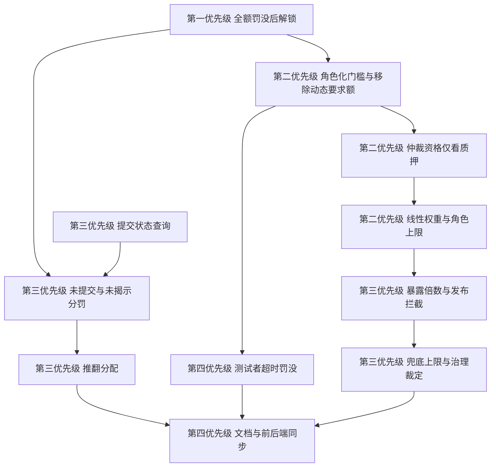

# 质押门槛与奖惩机制：需求规格（确认版）

> 版本：v1.0 · 2026-10-24 · 计价单位：AGT
> 适用：发布池、测试池、仲裁池（含复核者）的准入门槛、质押上限、锁仓、罚没与奖励。
> 本文所有条款为最终需求。实现完成后，须将本文结论回写 `01-RULES.md` 的第二章 2.3、第五章、第七章、第八章。
> 参数一律先写中文名称，代码中的参数标识集中列在第 9 章参数表。

---

## 1. 目标与范围

### 1.1 目标

1. 仲裁与测试的准入只看代币质押，不设历史条件。
2. 三个池的质押量级与各自承担的风险匹配。
3. 罚没与奖励随争议标的浮动，使诚实参与的期望收益为正，作恶的期望收益为负。
4. 任何已发布的任务，其争议标的都在仲裁池的经济安全范围内。

### 1.2 范围内

- 发布、测试、仲裁（含复核者）三池的准入、上限、权重、锁仓。
- 仲裁与测试的罚没、奖励、罚没去向。
- 任务标的上限、发布时拦截、降级与兜底路径约束。
- 对应的合约、参数、文档与前后端同步。
- 经济模型 v3：任务扣费 `C` **100% 进入平台金库 `PlatformTreasury`**，不再按 65/15/10/10 拆分给 Agent；Agent 报酬全部来自挖矿发行（平台 10% / 执行者 65% / 测试者 15% / 仲裁者 10%）。无参与者时段的执行者 / 测试者 / 仲裁者份额打入零地址销毁（AGT `burn`，`totalSupply` 减少）。
- 案件费余额、推翻罚没份额、执行者债务份额、仲裁池超额仍进入 `PlatformTreasury`（不销毁）。平台金库是独立账户，不是 8 亿 AGT 的激励金库 `IncentiveVault`，部署时校验二者不得相同。
- 拒绝保证金已废弃，统一为申诉费（`computeAppealFee`），100% 支付给已揭示陪审员。
- 已知例外：代币项目（`agent-grid-contracts/token`）不在本期范围，`TaxDistributor` 的交易税销毁份额与 `AGTToken.burn()` 保持不变。

### 1.3 范围外

| 项 | 本期处理 | 不做的原因 | 本期的替代措施 |
|---|---|---|---|
| 角色互斥 | 保持不变 | 同一任务内一个钱包只能担一种角色，已实现，与本次奖惩和门槛调整无关 | — |
| 发布者质押公式 | 保持不变 | 发布者质押随预留自动放大，T5（28 天）所需约 42 万，与仲裁门槛同量级，无需调整 | — |
| B 级串通委员会 | 不做 | 需要新增多签委员会、证据标准与延时执行机制，属于治理机制的新增；证据标准（哪些链下证据加链上旁证足以罚没）尚未定义，仓促上线会引入误罚风险 | 只对链上可验证的 A 级串通执行没收全部质押并永久禁入；仅聊天截图类证据不得作为罚没依据 |
| 30 天罚没锁仓账户 | 不做 | 它的作用是给复核推翻留出回滚窗口；本期没有协议复核层，没有需要回滚的对象 | 终审为终局，罚没即时执行 |
| 协议复核层 | 不做 | 需要新的复核角色、保证金与裁决流程，改动面超出本次"奖惩与准入"范围；复核推翻后已分配罚没如何追回，规则未定义 | 终审为终局；以"争议标的不超过暴露倍数乘以质押"的上限与发布时拦截限制单案风险 |
| 关联簇排除 | 不做 | 注册表中的关联簇字段没有写入方，链上始终为空；要启用需先确定谁写入、依据什么数据判定同一控制人，这是链下身份与数据源问题，不属于质押与罚没规则 | 沿用每案证据机制：开案时由协议签名的案件证明提交回避名单与资金来源，并按"同一来源权重占比上限"限制同一来源的权重；另加线性权重使拆地址不增加总权重，每个地址仍需 100 万质押 |
| 测试者质量罚（报告与终局不一致） | 不做 | 报告与终局不一致可能是诚实分歧，链上无法与恶意区分；以此罚没会惩罚诚实的少数意见 | 只罚可客观判定的行为：超时未交报告（见 7.6）与 A 级串通 |

---

## 2. 术语与符号

| 符号 | 名称 | 含义 |
|---|---|---|
| V | 争议标的 | 被争议的执行者池金额，开案时由任务托管合约传入仲裁庭 |
| Y | 预留额 | 任务预留 = 最高档日费 × 运行天数，发布任务时锁定 |
| V上限 | 争议标的上界 | `Y × 执行者份额比例`（65%） |
| S | 质押 | 单个验证者的质押量 |
| 仲裁准入质押、测试准入质押 | 准入门槛 | 分别为仲裁池、测试池的最低质押 |
| F | 案件费 | `max(5% × V, 6 AGT)` |
| L | 单案锁仓 | 陪审员为一个案件锁定的质押 |
| R | 单席多数费 | `F × 70% ÷ 终审多数派人数` |
| p | 串通发现率 | 串通被发现并罚没的概率，取 30% |
| k | 必须买通人数 | 为让错误结果维持，攻击者需买通的最少人数 = `⌊终审人数 ÷ 2⌋ + 1` |
| μ | 暴露倍数 | `k × p`，约束 `V ≤ μ × S` |
| U | 标的上限 | 当前模式下允许发布的争议标的最大值 |
| Z | 罚没总额 | 一审多数方被罚没的合计 |

---

## 3. 最终决策

### 3.1 门槛与上限

| 项 | 决定 |
|---|---|
| 发布池 | 基础质押 10 AGT + 10% × 在途预留总额 |
| 测试池准入 | 质押 ≥ **20,000 AGT** |
| 仲裁池准入（含复核者） | 质押 ≥ **1,000,000 AGT**，唯一条件 |
| 存款总额上限 | **3,000,000 AGT**（测试与仲裁共用一份质押，全局上限） |
| 角色权重上限 | 仲裁 3,000,000；测试 200,000 |
| 抽选权重 | 线性：`min(质押, 角色权重上限) × 响应率 × 活跃系数` |
| 同一份质押 | 可同时满足测试池与仲裁池；同任务内互斥保持不变 |

### 3.2 陪审规模与标的

| 项 | 决定 |
|---|---|
| 满编（池 ≥ 40） | 一审 11 人，终审 21 人 |
| 降级（18 ≤ 池 < 40） | 一审 5 人，终审 9 人 |
| 最小池规模 | **18** |
| 终审改判规则 | 简单多数 |
| 暴露倍数 | 满编 3.3，降级 1.5 |
| 兜底（池 < 18） | 3 名测试者，2 票通过，仅限 `V ≤ 12,000 AGT` |
| T5 最长天数 | **28 天** |
| 发布时拦截 | 创建任务时校验争议标的上界不超过当前模式的标的上限 |

### 3.3 锁仓与罚没

| 项 | 决定 |
|---|---|
| 单案锁仓 | `L = min(max(5% × V, 50 AGT), 10% × S)` |
| 并发案件数 | 3 |
| 拒席 | 不罚没 |
| 已确认席位未提交 | 罚 20% × L |
| 已提交未揭示 | 罚 100% × L |
| 一审多数被终审推翻 | 罚 100% × L |
| 终审少数 | 不罚（0%） |
| A 级串通 | 没收全部质押 + 永久禁入 |
| 测试者超时未交报告 | 罚 `min(5 × 应得报酬, 10% × 质押)` |

### 3.4 奖励分配

| 项 | 决定 |
|---|---|
| 申诉方奖励 | `min(10 × R, Z)` |
| 剩余罚没 | 平台金库 30%；正义方 70%，人头均分 |
| 正义方 | 终审多数派 ∪ 一审中与终审裁决一致的少数派（未揭示者不计） |
| 申诉资格 | 发布者、执行者 |
| 申诉保证金 | `2 × F` |
| 池不足时的高标的案件 | 等待池恢复；超过 336 小时由治理裁定 |

---

## 4. 数学模型

### 4.1 抗贿赂约束

攻击者收买一审多数后，要让错误结果在终审中维持，须买通终审中"能阻止改判的最少人数 k"。被买通者被发现的预期损失为 `p × S`，攻击不划算的条件：

```
k × p × S  ≥  V          即   V ≤ μ × S
```

| 模式 | 终审人数 | k | μ（p = 30%） | S = 100 万时 V 上限 |
|---|---:|---:|---:|---:|
| 满编 | 21 | 11 | 3.3 | 330 万 |
| 降级 | 9 | 5 | 1.5 | 150 万 |
| 兜底 | 3 | 2 | 0.6 | 测试准入质押 2 万时为 12,000 |

### 4.2 收入与流动性约束

- 收入：`S ≤ 年收入 ÷ 资金成本 25%`。`S = 100 万` 需要年收入 ≥ 25 万 AGT。仲裁者收入来源：
  - 复核份额：扣费的 10% 在本任务复核者间均分（T1、T2 一人，T3 三人），是主要来源。以 T3 扣费 60 万、3 名复核者计，每人约 2 万/任务。
  - 案件费：最大 T3 的 `V = 39 万`，`F = 1.95 万`，多数派 70% 由 6 人平分，每人约 2,275。
  - 出席费：每人每案最多 0.5 AGT。
- 流动性：`池规模 × S ≤ 初始流动性池储备 2 亿 AGT`。

| 池规模 | 质押合计 | 占流动性池 |
|---|---:|---:|
| 最小池 18 | 1,800 万 | 9% |
| 满编 40 | 4,000 万 | 20% |

### 4.3 各档任务覆盖

`V上限 = 0.65 × Y`。

| 档位 | 日费 | 最大天数 | 预留额最大 | V 最大 | 满编（330 万） | 降级（150 万） | 兜底（1.2 万） |
|---|---:|---:|---:|---:|:-:|:-:|:-:|
| T1 | 300 | 7 | 2,100 | 1,365 | 覆盖 | 覆盖 | 覆盖 |
| T2 | 2,000 | 14 | 28,000 | 18,200 | 覆盖 | 覆盖 | 9 天内 |
| T3 | 20,000 | 30 | 60 万 | 39 万 | 覆盖 | 覆盖 | 不覆盖 |
| T4 | 60,000 | 45 | 270 万 | 175.5 万 | 覆盖 | 38 天内 | 不覆盖 |
| T5 | 150,000 | 28 | 420 万 | 273 万 | 覆盖，余量 17% | 15 天内 | 不覆盖 |

### 4.4 单案锁仓与盈亏

```
L  = min( max( 5% × V, 50 ),  10% × S )
盈亏平衡的被推翻概率 = R ÷ ( R + L )
```

- 满编一审（多数 6 人）：`R = 0.117 × F`，`L = F`（V ≤ 200 万时），盈亏平衡概率约 10.4%。
- 降级一审（多数 3 人）：`R = 0.233 × F`，`L = F`（V ≤ 200 万时），盈亏平衡概率约 18.9%。
- `V > 2 × S`（200 万）时，锁仓占质押的上限（10%）生效。

### 4.5 对串通发现率的敏感性

| 发现率 p | 满编 V 上限 | T5 最长天数 | 降级 V 上限 | 兜底 V 上限 |
|---:|---:|---:|---:|---:|
| 20% | 220 万 | 约 20 天 | 100 万 | 8,000 |
| 30%（采用） | 330 万 | 约 31 天（取 28） | 150 万 | 12,000 |
| 50% | 550 万 | 约 52 天 | 250 万 | 20,000 |

发现率为模型假设。运营中实际发现率低于 30% 时，下调两档暴露倍数与兜底标的上限，并缩短 T5 最长天数。

---

## 5. 三个池的规则

### 5.1 发布池

```
发布者所需质押 = 发布者基础质押 + 发布者预留质押比例 × 在途预留额合计
              = 10 AGT + 10% × 在途预留额合计
```

| 任务 | 预留额 | 所需质押 |
|---|---:|---:|
| T1 满额 | 2,100 | 220 AGT |
| T3 满额 | 60 万 | 60,010 AGT |
| T5（28 天） | 420 万 | 420,010 AGT |

### 5.2 测试池

| 项 | 要求 |
|---|---|
| 入池 | 质押 ≥ 测试准入质押（20,000）；加入测试池时校验 |
| 保持 | 质押低于门槛时立即不具备抽选资格；补足后立即恢复 |
| 权重 | `min(质押, 200,000) × 响应率` |
| 并发 | 不占仲裁并发额度 |
| 退出 | 首次质押后锁定 14 天；申请退出后冷却 7 天 |
| 罚没 | 见 7.6 |

### 5.3 仲裁池（含复核者）

**准入**

| 条件 | 要求 |
|---|---|
| 质押 | ≥ 仲裁准入质押（1,000,000） |
| 债务 | 无未清偿罚没；注册表无记录视为无债务 |
| 暂停 | 不在暂停期（纪律暂停与响应率暂停） |
| 响应率 | ≥ 最低响应率（50%） |

除上表外不设任何准入条件：不要求质押时长、不要求测试历史、不要求注册档案。

**权重**：`min(质押, 3,000,000) × 响应率 × 活跃系数`。连续 5 次终审少数后活跃系数为 50%。

**复核者**：从仲裁池抽取，资格同仲裁者。仲裁池人数低于冷启动阈值（10）时，复核者可从全部合格验证者中抽取。

**治理白名单**：只用于批量加入仲裁池，不豁免任何质押要求。

**案件上限**

- 并发案件数上限为 3；最坏同时锁仓 `3 × 10 万 = 30 万 ≤ 100 万`。
- 被抽陪审员须满足 `V ≤ 质押 × 当前模式暴露倍数`。

**纪律**

| 事件 | 处理 |
|---|---|
| 被终审推翻达 2 次 | 暂停 720 小时 |
| 被终审推翻达 3 次 | 取消资格；满 8,760 小时（约 365 天）后自动恢复 |
| 连续 5 次终审少数 | 活跃系数降为 50% |
| 响应率低于 50% | 暂停 720 小时 |

### 5.4 质押上限与退出

- 存款后总质押超过 3,000,000 AGT 的存款被拒绝。
- 退出：首次质押后锁定 336 小时；申请退出后冷却 168 小时；无进行中的案件才可提走。
- 设置上限的目的：防止少数大户垄断抽选与席位；避免多余质押抽走流动性池的流动性；控制单人风险暴露；使拆地址无套利。

### 5.5 线性权重与防拆分

```
一个 200 万地址 → 权重 200 万
两个 100 万地址 → 权重 100 万 + 100 万 = 200 万
```

拆分不增加总权重。

---

## 6. 陪审规模、发布拦截与兜底

### 6.1 规模

| 池内合格仲裁者数量 | 模式 | 一审 | 终审 |
|---|---|---:|---:|
| ≥ 40 | 满编 | 11 | 21 |
| 18 至 39 | 降级 | 5 | 9 |
| < 18 | 兜底 | 3 名测试者，2 票通过 | — |

- 终审排除一审全部成员。
- 降级模式一审加终审需 14 个互不重复的陪审员，最小池 18 提供约 25% 冗余。
- 通过票数为 `⌊人数 ÷ 2⌋ + 1`；最低有效揭示人数为 `⌈70% × 人数⌉`。

### 6.2 暴露倍数

```
满编：μ = 11 × 0.30 = 3.3      （暴露倍数（满编）= 33000，单位为万分比）
降级：μ =  5 × 0.30 = 1.5      （暴露倍数（降级）= 15000，单位为万分比）
```

模式取仲裁抽选合约中的满编状态，该状态带 168 小时的恢复迟滞。

### 6.3 发布时拦截

创建任务时必须执行：

```
争议标的上界 V上限 = 预留额 × 执行者份额比例 ÷ 10000（即 65%）

若 合格仲裁者数量 < 最小池规模：  标的上限 U = 兜底标的上限
否则若处于满编状态：              U = 暴露倍数（满编）÷ 10000 × 仲裁准入质押
否则：                            U = 暴露倍数（降级）÷ 10000 × 仲裁准入质押

要求 V上限 ≤ U，否则拒绝创建并提示"仲裁容量不足"
```

- 仲裁庭提供查询接口返回当前标的上限，供创建任务与前端使用。
- 标的上限由仲裁准入质押推出，门槛调整后自动同步。
- 仲裁庭未设置时跳过拦截。

### 6.4 兜底与高标的案件

| 情形 | 处理 |
|---|---|
| 池 < 18 且 `V ≤ 兜底标的上限`（12,000） | 3 名测试者 2 票裁决，二元结果，不可申诉 |
| 池 < 18 且 `V > 兜底标的上限` | 案件停留在"抽签中"，不进入兜底；任何人可重复触发抽签，池恢复后继续 |
| 等待超过停滞等待时限（336 小时） | 治理角色可对该案件裁定，按常规路径执行；不罚没任何陪审员 |

兜底标的上限 `12,000 = 2 × 0.3 × 测试准入质押 2 万`。测试准入质押或发现率变化时同步调整。

---

## 7. 罚没与奖励

### 7.1 基数

罚没以本案锁仓 L 为基数。L 在陪审员确认席位时按当时标的锁定。只有持有锁仓的席位才会被罚。

### 7.2 仲裁罚没表

| 情形 | 触发 | 罚没 | 去向 |
|---|---|---|---|
| 拒席 | 确认窗内未确认席位 | 0；计入响应率 | — |
| 未提交 | 已确认席位，提交窗内未提交投票承诺 | 20% × L | 仲裁池 |
| 未揭示 | 已提交承诺，揭示窗内未揭示 | 100% × L | 仲裁池 |
| 一审被推翻 | 一审多数方被终审推翻 | 100% × L | 见 7.3 |
| 终审少数 | 终审中的少数方 | 0（可通过参数调整，范围 0 到 30%） | — |
| A 级串通 | 链上可验证的串通 | 没收全部质押 + 永久禁入 | 举报人 10%；仲裁池 90% |

规则：
- 同一席位同一轮只取最重的一项罚没。
- 罚没不超过本案锁仓。
- 终审维持一审结论时，一审多数不追加质量罚。
- 罚没后质押低于门槛，立即停抽；补足后立即恢复。
- 无论罚没比例多少（含 100%），罚没后必须解除该案件的并发占位，使验证者的在办案件数与仍处于激活状态的案件锁一致。
- 仅聊天截图类证据不得作为罚没依据。

### 7.3 推翻时的分配

```
R         = F × 案件费多数派份额 ÷ 10000 ÷ 终审多数派人数
申诉方实得 = min( 申诉方奖励倍数 × R,  Z )            默认 10 × R
剩余额     = Z − 申诉方实得
平台       = 剩余额 × 30%    → 平台金库
正义方     = 剩余额 × 70%    → 终审多数派 ∪ 一审正确少数派，已揭示者人头均分
```

- 申诉成功时，申诉保证金 `2 × F` 全额退还。
- 申诉失败时，保证金按案件费分配规则处理，一审与终审均不追加质量罚。
- 分配总额必须恒等于实际罚没额，尾差归入最后一份。
- 一审与终审人员互斥，正义方两部分无重叠。

### 7.4 案件费

```
F = max( 5% × V, 6 AGT )
败诉案件费：多数派 70% / 胜诉方 20% / 平台 10%
申诉保证金 = 2 × F
出席费上限 = 0.5 AGT / 人 / 案
```

### 7.5 串通

| 项 | 规则 |
|---|---|
| A 级 | 全额没收质押 + 永久禁入；举报人 10%，其余 90% 进仲裁池 |
| 触发入口 | 仲裁结算合约的串通举报接口：由协议签名者对"被举报地址、举报人、证据哈希、随机数、截止时间"签名，举报人提交；被举报地址可以是任意验证者（仲裁者、测试者），不要求在案件陪审团内 |
| 执行 | 校验签名后全额没收，并将该地址写入永久禁入名单（见 8.2） |
| 治理直接处置 | 治理角色仍可直接执行全额没收，同样触发禁入 |

### 7.6 测试者罚没

| 情形 | 触发 | 罚没 | 去向 |
|---|---|---|---|
| 超时未交报告 | 接受任务后在报告窗口（含延长窗）内未交报告 | `min( 测试者未交报告罚没倍数 × 应得报酬, 测试者罚没占质押上限 × 质押 )`，默认 5 倍、封顶 10% | 仲裁池 |
| A 级串通 | 同 7.5 | 没收全部质押 | 同 7.5 |

- 应得报酬 = 该测试者在本任务应得份额（测试池 15% ÷ 测试者人数）。
- 测试者罚没不占用并发额度，也不依赖案件锁仓。
- 测试者不是申诉方。

### 7.7 算例

**T3 满额**：`V = 39 万`，满编，一审 11 人、多数 6 人。

| 项 | 数值 |
|---|---:|
| 案件费 F | 19,500 |
| 单案锁仓 L | 19,500 |
| 单席多数费 `R = 0.7 × 19,500 ÷ 6` | 2,275 |
| 申诉保证金 | 39,000 |
| 罚没总额 `Z = 6 × 19,500` | 117,000 |
| 申诉方 `10 × R` | 22,750 |
| 剩余额 | 94,250 |
| 平台 30% | 28,275 |
| 正义方 70% | 65,975（终审 11 人均为多数时人均约 5,998） |
| 盈亏平衡的被推翻概率 | 约 10.4% |

**T5（28 天）**：`V = 273 万`，满编，一审多数 6 人。

| 项 | 数值 |
|---|---:|
| 案件费 F | 136,500 |
| 单案锁仓 `L = min(136,500, 100,000)` | 100,000 |
| 单席多数费 `R = 0.7 × 136,500 ÷ 6` | 15,925 |
| 罚没总额 `Z = 6 × 100,000` | 600,000 |
| 申诉方 `10 × R` | 159,250 |
| 剩余额 | 440,750 |
| 平台 30% | 132,225 |
| 正义方 70% | 308,525（11 人均分约 28,048） |

**T1**：`V = 1,365`，`F = 68.25`，`L = 68.25`，`R ≈ 7.96`。

---

## 8. 实现需求

> 合约为可升级合约，存储布局快照在 `protocol/storage-layout/*.json`，修改只能追加变量。接口定义变化后须重新生成 `shared/abi`，并同步到后端、前端、工具包三个仓库的 `vendor/shared`。
> 本章函数与变量标识为代码实际名称，说明列为中文要求。

### 8.1 第一优先级：全额罚没后的解锁

结算合约中的解锁步骤必须按"案件是否仍处于激活状态"判断是否解锁，不得按锁仓余额是否非零判断。验证者质押合约需对外提供"案件是否激活"的查询，供结算合约使用。验收：验收 1、验收 2。

### 8.2 验证者质押合约

合约：`ValidatorStaking`

| 需求 | 说明 |
|---|---|
| 角色化资格 | 新增 `meetsMinimum(validator, role)`，角色分为测试者与仲裁者，阈值分别取测试准入质押与仲裁准入质押；资格按当前质押实时判定 |
| 移除动态要求额 | 资格不再依赖动态质押要求额及其更新、检查点逻辑；相关参数移除 |
| 存款上限 | 存款时按存款总额上限（3,000,000）校验 |
| 线性权重 | 新增 `weightOf(validator, cap)`，返回 `min(质押, 上限)` |
| 测试者罚没接口 | 新增 `slashByRole`，不占并发、不依赖案件锁仓，仅授权测试者分配合约（新增测试者角色） |
| 永久禁入 | 全额没收执行后将地址记入禁入名单；名单内地址不能存款，角色化资格恒为否 |
| 解锁案件 | 对锁仓余额为 0 的激活案件必须可解锁 |

### 8.3 仲裁抽选合约

合约：`ArbitrationSelection`

| 需求 | 说明 |
|---|---|
| 基础资格判定 `_baseEligible` | 仅检查：仲裁者角色化资格、暂停、响应率、债务、纪律取消资格；注册表查询失败（未注册）按无债务、无暂停放行 |
| 恢复 | 取消资格后以时间恢复：满取消资格恢复时长（8,760 小时） |
| 权重 `_weight` | 仲裁权重上限内的线性质押 × 响应率 × 活跃系数 |
| 可选判定 `_selectable` | 暴露校验 `V ≤ 质押 × 当前模式暴露倍数`，模式按满编状态取两档倍数之一 |
| 治理白名单 | 仅批量入池，不豁免质押要求 |

### 8.4 仲裁庭合约与规则库

合约：`ArbitrationCourt`、`CourtRules`

| 需求 | 说明 |
|---|---|
| 抽签 `drawPanel` | 池低于最小池规模时：`V ≤ 兜底标的上限` 才进入兜底，否则案件保持"抽签中" |
| 停滞案件裁定 `resolveStalledCase` | 治理角色；仅在案件处于"抽签中"、因池不足而等待且已超过停滞等待时限时可调用；裁定后走常规执行路径 |
| 标的上限查询 `maxDisputeValue()` | 返回 6.3 的标的上限 U |
| 陪审规模 | 池阈值读取最小池规模 |
| 锁仓计算 | `L = min(max(5% × V, 锁仓下限), 锁仓占质押上限 × 质押)` |

### 8.5 仲裁投票合约

合约：`ArbitrationVoting`

- 新增"某陪审员在某轮是否已提交承诺"的查询，并让逐轮状态同时返回提交状态，使结算能区分"未提交"与"已提交未揭示"。
- 投票合约的接口定义同步更新。

### 8.6 仲裁结算合约

合约：`ArbitrationSettlement`

| 需求 | 说明 |
|---|---|
| 逐轮结算 | 未提交 → 按未提交罚没比例；已提交未揭示 → 按未揭示罚没比例；终审少数 → 按终审少数罚没比例 |
| 推翻分配 | 按 7.3：申诉方 `min(申诉方奖励倍数 × R, Z)`；剩余按推翻罚没平台份额给平台金库、按推翻罚没正义方份额给正义方；尾差归最后一份 |
| 校验 | 推翻罚没平台份额与正义方份额之和等于 10000 |
| 解锁 | 见 8.1 |
| 平台金库地址 | 新增配置项 |

### 8.7 测试者分配合约

合约：`TesterAssignment`

| 需求 | 说明 |
|---|---|
| 入池与抽选 | 加入测试池与抽选判定使用测试者角色化资格 |
| 权重 | 线性，上限为测试权重上限 |
| 超时罚没 | 报告窗口（含延长窗）结束后，对未交报告者调用 `slashByRole`；"应得报酬"由任务托管合约在分配时传入 |

### 8.8 任务托管合约

合约：`TaskEscrow`

- 创建任务时执行 6.3 的校验，新增错误"仲裁容量不足"，携带争议标的上界与标的上限两个数值。

### 8.9 参数文件与文档

- 更新 `shared/params/params.json`、`shared/params/ranges.json`，以及后端、前端、工具包三个仓库中 `vendor/shared/params` 的副本；`ParamKeys.sol` 新增常量；参数注册表的初始化范围随 `ranges.json` 重新生成。
- 回写 `01-RULES.md` 的 2.3（仲裁资格）、5.1（验证者质押）、第七章（规模、案件费、惩罚）、8.5、8.6，并同步各仓库中的副本。
- 前端：展示角色化门槛、池规模与模式、发布时标的上限、测试者罚没；发布页对超限任务给出明确提示。
- 后端：索引罚没事件及罚没原因；缓存当前标的上限；更新与门槛相关的接口与文案。

---

## 9. 参数表

### 9.1 新增与取值

| 参数名称 | 代码标识 | 值 | 范围 |
|---|---|---:|---|
| 仲裁准入质押 | `arbitratorMinStakeAgt` | 1,000,000 | 100,000 到 5,000,000 |
| 测试准入质押 | `testerMinStakeAgt` | 20,000 | 1,000 到 200,000 |
| 存款总额上限 | `validatorStakeAgt.voluntaryMax` | 3,000,000 | 20,000 到 10,000,000 |
| 仲裁权重上限 | `arbitratorWeightCapAgt` | 3,000,000 | 1,000,000 到 10,000,000 |
| 测试权重上限 | `testerWeightCapAgt` | 200,000 | 20,000 到 1,000,000 |
| 暴露倍数（满编） | `arbExposureMultiplierBps.Full` | 33000 | 10000 到 60000 |
| 暴露倍数（降级） | `arbExposureMultiplierBps.Degraded` | 15000 | 5000 到 30000 |
| 兜底标的上限 | `arbFallbackMaxDisputeValueAgt` | 12,000 | 1,000 到 100,000 |
| 停滞等待时限（小时） | `arbPendingMaxHours` | 336 | 72 到 720 |
| 最小池规模 | `arbMinimumPoolSize` | 18 | 14 到 30 |
| 满编池规模阈值 | `arbFullPanelThreshold` | 40 | 30 到 80 |
| 锁仓比例（万分比） | `caseLockBps` | 500 | 200 到 1000 |
| 锁仓下限 | `caseLockMinAgt` | 50 | 0.5 到 500 |
| 锁仓占质押上限（万分比） | `caseLockStakeCapBps` | 1000 | 1000 到 3000 |
| 未提交罚没比例（万分比） | `missedCommitSlashBps` | 2000 | 0 到 5000 |
| 未揭示罚没比例（万分比） | `missedRevealSlashBps` | 10000 | 0 到 10000 |
| 终审少数罚没比例（万分比） | `finalMinoritySlashBps` | 0 | 0 到 3000 |
| 申诉方奖励倍数 | `challengerRewardMultiple` | 10 | 1 到 20 |
| 推翻罚没平台份额（万分比） | `overturnPlatformShareBps` | 3000 | 固定（与下项之和为 10000） |
| 推翻罚没正义方份额（万分比） | `overturnRighteousShareBps` | 7000 | 固定 |
| 申诉保证金倍数（万分比） | `appealBondMultiplierBps` | 20000 | 15000 到 30000 |
| 取消资格恢复时长（小时） | `arbDisqualifyHours` | 8760 | 2160 到 17520 |
| 测试者未交报告罚没倍数 | `testerMissReportSlashMultiple` | 5 | 1 到 10 |
| 测试者罚没占质押上限（万分比） | `testerSlashStakeCapBps` | 1000 | 500 到 2000 |
| T5 最长天数 | `tierDaysMax.T5` | 28 | 14 到 120 |
| 并发案件上限 | `arbitratorConcurrentCasesMax` | 3 | 1 到 5 |
| 首次质押锁定时长（小时） | `validatorInitialLockHours` | 336 | 168 到 720 |
| 退出冷却时长（小时） | `validatorExitCooldownHours` | 168 | 72 到 336 |
| 最低响应率（万分比） | `arbResponseRateMinBps` | 5000 | 3000 到 8000 |
| 暂停所需被推翻次数 | `arbOverturnPauseCount` | 2 | 2 到 4 |
| 取消资格所需被推翻次数 | `arbOverturnDisqualifyCount` | 3 | 3 到 6 |
| 触发降权的连续终审少数次数 | `arbMinorityStreakPenaltyCount` | 5 | 3 到 10 |

### 9.2 移除

| 参数名称 | 代码标识 |
|---|---|
| 原统一暴露倍数 | `arbitrationExposureMultiplier` |
| 原未投票罚没比例 | `missedVoteSlashBps` |
| 原推翻分配：终审多数份额 | `overturnFinalMajorityShareBps` |
| 原推翻分配：受害方份额 | `overturnVictimShareBps` |
| 原推翻分配：销毁份额 | `overturnBurnShareBps` |
| 原仲裁者质押时长要求 | `arbitratorStakeAgeHours` |
| 原仲裁者一致测试次数要求 | `arbitratorAlignedTestsMin` |
| 原动态质押要求额下限、上限 | `validatorStakeAgt.min`、`validatorStakeAgt.dynamicMax` |
| 原动态质押要求额的收入窗口、收入倍数、日调整幅度、补足宽限时长 | `validatorIncomeWindowHours`、`validatorIncomeMultiplierBps`、`validatorStakeDailyAdjustmentBps`、`validatorTopUpGraceHours` |

---

## 10. 上线与迁移

### 10.1 冷启动与门槛爬坡

启用 1,000,000 门槛需要至少 18 个地址各质押 100 万（1,800 万 AGT）。启动期按下表调整仲裁准入质押；标的上限随门槛自动缩放。

| 阶段 | 仲裁准入质押 | 满编 V 上限 | 降级 V 上限 |
|---|---:|---:|---:|
| 启动期 | 100,000 | 33 万 | 15 万 |
| 过渡期 | 500,000 | 165 万 | 75 万 |
| 稳态 | 1,000,000 | 330 万 | 150 万 |

- 池规模不足 18 期间，标的上限等于兜底标的上限；兜底标的上限与测试准入质押同步调整。
- 门槛上调须提前 7 天公布，生效后 7 天内补足质押，否则不具备抽选资格。

### 10.2 存量

- 现有验证者质押须补足到对应门槛后才能入池；已有质押可正常退出。
- 动态要求额机制移除后，不再依据原要求额判定资格。

### 10.3 币价

门槛以 AGT 数量计，不设美元地板。每季度评估仲裁准入质押、测试准入质押与标的上限；币价大幅变化时按 10.1 的公告规则通过治理调整。

### 10.4 实施顺序



---

## 11. 验收标准

### 11.1 缺陷与不变量

| 编号 | 用例 |
|---|---|
| 验收 1 | 陪审员在某案被 100% 罚没后，该案不再处于激活状态、在办案件数递减、已锁定额同步减少 |
| 验收 2 | 上述陪审员冷却期满后可成功提走质押 |
| 验收 3 | 不变量：任意时刻已锁定额 ≤ 质押；在办案件数等于激活中的案件锁数；罚没总额等于各接收方到账合计，无尾差丢失 |

### 11.2 准入与上限

| 编号 | 用例 |
|---|---|
| 验收 4 | 质押 999,999 不能加入仲裁池；1,000,000 可加入 |
| 验收 5 | 质押 19,999 不能加入测试池；20,000 可加入 |
| 验收 6 | 未在注册表登记、无测试记录的 100 万质押地址可加入仲裁池并被抽中 |
| 验收 7 | 恰为门槛的仲裁者被罚没一次后立即不再被抽选；补足后立即恢复 |
| 验收 8 | 存款后总质押超过 3,000,000 被拒绝 |
| 验收 9 | 同一份质押同时满足两个池，同任务内仍互斥 |
| 验收 10 | 权重线性：一个 200 万地址与两个 100 万地址总权重相同 |
| 验收 11 | 测试者质押 50 万时权重等同 20 万 |

### 11.3 标的上限与发布拦截

| 编号 | 用例 |
|---|---|
| 验收 12 | 满编池下争议标的上界 273 万可发布；超过 330 万被拒 |
| 验收 13 | 降级池下争议标的上界 175.5 万被拒；140 万可发布 |
| 验收 14 | 池 < 18 时，争议标的上界大于 12,000 的任务被拒 |
| 验收 15 | T5 运行天数超过 28 被拒 |
| 验收 16 | 已发布任务发生争议时，若池降级导致 V 超限：案件保持"抽签中"、不进入兜底；池恢复后可继续 |
| 验收 17 | V 超过"质押 × 当前模式暴露倍数"的陪审员不被抽中 |

### 11.4 罚没与奖励

| 编号 | 用例 |
|---|---|
| 验收 18 | 已确认席位未提交：罚 20% × L，入仲裁池 |
| 验收 19 | 已提交未揭示：罚 100% × L，入仲裁池 |
| 验收 20 | 未确认席位：无罚没 |
| 验收 21 | 终审少数默认不罚；终审少数罚没比例调大后生效 |
| 验收 22 | 一审多数被推翻：每人罚 L；申诉方实得 `min(10 × R, Z)`；剩余 30% 平台、70% 正义方；总额恒等 |
| 验收 23 | 正义方含一审与终审一致的少数派；未揭示者不分 |
| 验收 24 | `V = 273 万` 时 `L = 10 万`；`V = 39 万` 时 `L = 1.95 万` |
| 验收 25 | 终审维持时，一审多数不追加质量罚 |
| 验收 26 | A 级串通：全额没收、地址永久禁入、举报人得 10% |
| 验收 27 | 被推翻 2 次暂停、3 次取消资格；满 8,760 小时后恢复 |
| 验收 28 | 测试者超时未交报告：罚 `min(5 × 应得报酬, 质押 × 10%)`，入仲裁池 |
| 验收 29 | 测试者罚没不占在办案件数 |

### 11.5 兜底与停滞

| 编号 | 用例 |
|---|---|
| 验收 30 | 池 < 18 且 `V ≤ 12,000`：走 3 名测试者 2 票兜底 |
| 验收 31 | 池 < 18 且 `V > 12,000`：不走兜底，保持"抽签中" |
| 验收 32 | 等待超过 336 小时后，治理可裁定停滞案件；未超时调用被拒；裁定不罚没陪审员 |

### 11.6 回归

| 编号 | 用例 |
|---|---|
| 验收 33 | 发布者质押公式、任务生命周期、分期释放、发行逻辑不变；仲裁场景测试与仲裁不变量测试全部通过 |
| 验收 34 | 存储布局检查通过（快照文件只追加） |

涉及的测试文件：`test-solidity/unit/ValidatorStaking.t.sol`、`unit/TesterAssignment.t.sol`、`scenario/ArbitrationScenario.t.sol`、`invariant/ArbitrationInvariants.t.sol`，以及任务托管合约发布拦截的单元测试。

---

## 12. 假设与运营约束

| 项 | 内容 | 失效时的措施 |
|---|---|---|
| 串通发现率 p = 30% | 决定所有暴露倍数、标的上限、T5 天数、兜底上限 | 下调两档暴露倍数与兜底标的上限，缩短 T5 最长天数 |
| 争议标的上界 = 0.65 × 预留额（执行者份额参数） | 发布拦截的上界 | 实际 V 低于该值时拦截偏保守，不会不安全 |
| 测试者月收入约 6,000 到 7,000 AGT | 测试准入质押 2 万的依据 | 用链上近 30 天测试者收入中位数重新标定 |
| 收入主要来自复核份额 | 100 万门槛的可持续性 | 任务量不足时放缓门槛爬坡 |

### 12.1 逻辑闭环说明

本期不做的项不影响主流程闭合。各环节如何闭合，以及依赖什么：

| 环节 | 闭合方式 | 依赖 |
|---|---|---|
| 准入与资格 | 质押实时判定，罚后低于门槛立即停抽 | 无外部依赖 |
| 单案风险上限 | `V ≤ μ × S`，发布时拦截，已发布案件池不足时等待或治理裁定 | 发现率假设 |
| 过程失职（未提交、未揭示） | 锁仓内罚没，链上即时执行 | 无外部依赖 |
| 一审错误 | 被终审推翻则罚 100% × L，并奖励申诉方与正义方 | 无外部依赖 |
| 终审错误或串通 | 终审为终局，无链上罚没；靠 A 级串通举报全额没收，期望损失 `k × p × S ≥ V` | 协议签名者对举报出具签名；发现率取决于实际发现情况 |
| 拆地址 / 多地址占席 | 每案证据中的回避名单与来源权重占比上限；线性权重；每个地址需 100 万质押 | 协议签名的案件证明（开案时提交，缺失则无法抽签） |
| 池不足 | 兜底（`V ≤ 12,000`）或等待 + 治理裁定 | 治理角色 |
| 测试者失职 | 超时未交报告罚没；作恶按 A 级串通处理 | 见下 |

对"不做"各项的闭合结论：
- **B 级串通委员会、协议复核层、30 天罚没锁仓账户**：终审为终局、罚没即时执行，三者互相不依赖，缺少它们不会留下悬空环节。代价是只有协议签名者认定的 A 级证据才能罚没，证据不足的串通不受罚，实际发现率会低于假设，由上表"串通发现率"一行的失效措施兜住。
- **关联簇**：回避与来源占比由每案证据承担，关联簇字段不是必需路径。
- **测试者质量罚**：测试者给出不实报告，没有链上成本。该风险由发布者评审与拒绝、争议仲裁，以及 A 级串通处理来约束；属于接受的残余风险。测试者质押仅 2 万，单个测试者的影响面受任务的测试份额限制。

适用边界：
- 唯一门槛 100 万只能安全覆盖 `V ≤ 330 万`（满编）；T5 超过 28 天不在覆盖范围。
- 降级模式下 T4 超过约 35 天、T5 超过约 14 天的任务不在覆盖范围，由发布时拦截保证不会发布。
- 终审为终局，串通只能靠举报与 A 级证据处理。

---

## 附录：公式速查

```
暴露倍数          μ = k × p，  k = ⌊终审人数 ÷ 2⌋ + 1
安全条件          V ≤ μ × S
单案锁仓          L = min( max( 5% × V, 50 ),  10% × S )
案件费            F = max( 5% × V, 6 )
单席多数费        R = 0.7 × F ÷ 终审多数派人数
申诉方奖励        min( 10 × R, Z )
剩余额            Z − 申诉方奖励；平台 30%、正义方 70%
盈亏平衡概率      R ÷ ( R + L )
任务预留额        Y = 最高档日费 × 运行天数
争议标的上界      V上限 = 0.65 × Y
发布者所需质押    10 + 10% × 在途预留额合计
抽选权重          min( 质押, 角色权重上限 ) × 响应率 × 活跃系数
流动性约束        池规模 × S ≤ 2 亿 AGT
收入约束          S ≤ 年收入 ÷ 25%
```
